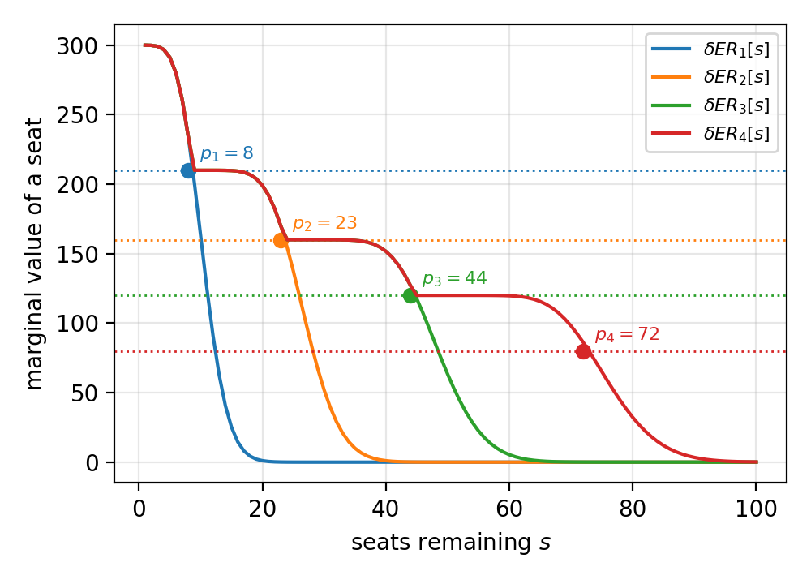
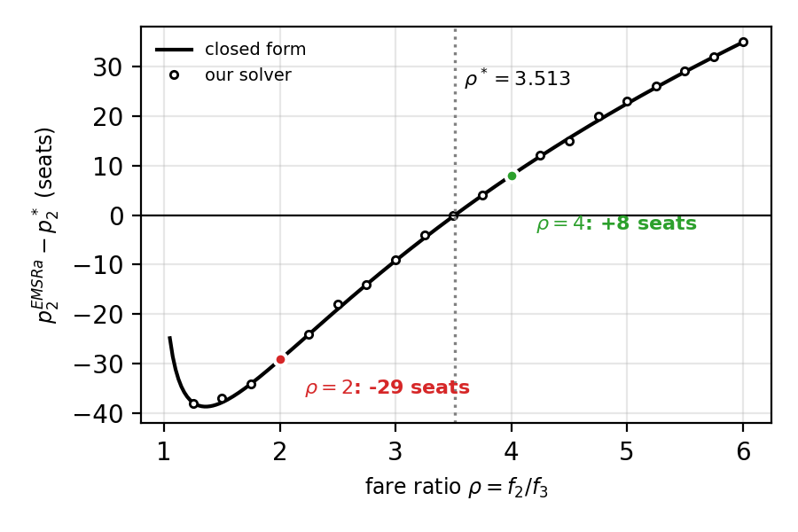
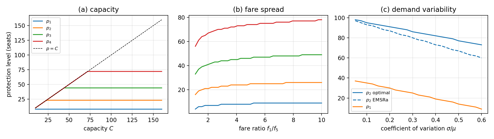
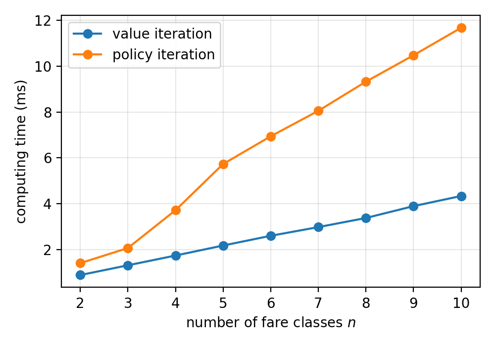
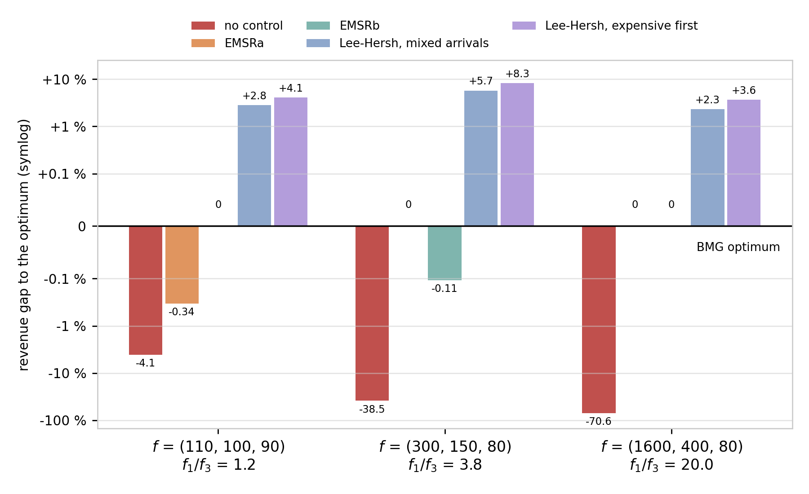

# Airline seat allocation with multiple nested fare classes
> Project of the course *Markov Decision Processes: Dynamic Programming and Applications* 
> Studying and reproducing Brumelle & McGill, *Airline Seat Allocation with Multiple Nested Fare Classes*, Operations Research 41(1), 1993 (BMG below), and add a few experiments of our own.


## Notation
Same notation as the paper:
- class 1 is the most expensive and books **last**, class n is the cheapest and books first, `fares[k-1] = f_k` with f_1 > … > f_n
- `X_k` is the demand of class k, `C` the capacity, `s` the number of seats left
- `p[k] = p_k` is the number of seats protected for classes 1..k (closed to class k+1), with `p[0] = p_0 = 0`
- `ER[k, s] = ER_k[s]` is the optimal expected revenue of the k most expensive classes with s seats

The problem is solved as an MDP with one stage per class (value iteration, backwards since class 1 books last):
$$
ER_0[s] = 0
$$
$$
ER_{k+1}[s] = E\left[\max_{(s - X_{k+1})^+ \leq q \leq s} f_{k+1}(s - q) + ER_k[q]\right]
$$
$$
p_k = \text{smallest } \arg\max_q \left(ER_k[q] - f_{k+1}q\right)
$$


## Files
| File | Content |
|---|---|
| `model.py` | demand laws (Poisson, negative binomial, rounded normal, rounded exponential), `solve_dp` (value iteration), `evaluate_nested_policy` (exact revenue of a policy), `policy_iteration` |
| `heuristics.py` | EMSRa (Belobaba 1987, eqs. (2)-(5) of BMG) and EMSRb (Belobaba 1992) |
| `extensions.py` | Monte Carlo simulation, Lee & Hersh (1993) model for any arrival order |
| `main.py` | every number of the report and the slides |
| `figures.py` | the figures below, saved in `figures/` (plus the slide version of figure 3) |


## Run
```
pip install numpy scipy matplotlib
python main.py      # about 1 min, prints all the results below
python figures.py   # figures/*.png
```


## Results
### 1. Checks of the solver
```
=== Checks of the solver ===
Littlewood (n=2): DP p1 = 16, formula p1 = 16
  n=2, f=(250,100): DP p1 = 16, EMSRa p1 = 16
  n=2, f=(300,80): DP p1 = 12, EMSRa p1 = 12
  n=2, f=(60,50): DP p1 = 16, EMSRa p1 = 16
ER_k concave for all k: True
levels p_1..p_4 = [8, 23, 44, 72] nested: True
dER_k <= dER_k+1 (ex. 3.9): True
value ER_5[100] = 13993.2589, exact evaluation of p* = 13993.2589
```
With 2 classes the solver gives back Littlewood's rule, and EMSRa is optimal as it should be. 
On the 5-class example (f = 300, 210, 160, 120, 80, Poisson means 10, 15, 20, 25, 30, C = 100) all the value functions are concave, the levels are nested, the marginal values are ordered as in exercise 3.9, and the exact evaluation of p* gives back the optimal value.

*Figure 1: marginal value of a seat δER_k[s] (solid) and next fare f_{k+1} (dotted). The protection level p_k is read at the crossing.*

### 2. Reproduction of Table I of the paper
Setting of BMG section 4: C = 100, f_1 = 1, normal demands with means 40, 60, 80 and std 16, 24, 32, rounded to integers. 
Published values in brackets.
| Ex. | f₃ | f₂ | p₁ | p₂ EMSRa (pub) | p₂ opt (pub) | Loss % (pub) | P[X₁ > p₁] | P[X₁ > p₁, X₁ + X₂ > p₂] |
|---:|---:|---:|---:|---:|---:|---:|---:|---:|
| 1 | 0.6 | 0.7 | 32 | 70 (70) | 80 (80) | 0.33 (0.37) | 0.680 | 0.582 |
| 2 | 0.6 | 0.8 | 27 | 80 (80) | 87 (87) | 0.30 (0.32) | 0.783 | 0.589 |
| 3 | 0.6 | 0.9 | 19 | 86 (86) | 91 (91) | 0.17 (0.19) | 0.900 | 0.594 |
| 4 | 0.7 | 0.8 | 27 | 64 (64) | 75 (75) | 0.36 (0.41) | 0.783 | 0.683 |
| 5 | 0.7 | 0.9 | 19 | 73 (73) | 82 (82) | 0.41 (0.45) | 0.900 | 0.694 |
| 6 | 0.8 | 0.9 | 19 | 57 (57) | 70 (70) | 0.43 (0.50) | 0.900 | 0.794 |

- all 18 protection levels are the published ones
- our losses are a bit smaller (0.02 to 0.07 point): the paper does not say how it rounded the normal law
- the last two columns should be f_2 and f_3 by eq. (7) of the paper: they are close but not equal because with integer demand the probabilities move by jumps

### 3. Table II: capacity
```
=== Table II (f2 = 0.9, f3 = 0.7) ===
C = 82: EMSRa loss = 0.50 %  (published 0.54 %)
C = 100: EMSRa loss = 0.41 %  (published 0.45 %)
C = 120: EMSRa loss = 0.32 %  (published 0.35 %)
C = 140: EMSRa loss = 0.22 %  (published 0.24 %)
C = 160: EMSRa loss = 0.13 %  (published 0.14 %)
```
Same decreasing trend as the paper: with a bigger cabin, protecting well matters less.

### 4. EMSRa can protect too many seats
With exponential demands (mean 1 = 100 seats, f_1 = 1) both rules can be solved by hand. 
Littlewood gives p_1 = ln(1/f_2). Writing p_2 = p_1 + d and ρ = f_2/f_3:

$$
P[X_1 > p_1, X_1 + X_2 > p_2] = (1 + d) e^(-p_2)
$$
$$
optimum (eq. 7):   (1 + d*) e^(-d*) = 1/ρ
$$
$$
EMSRa:             π^1 = ln(1/f_3), π^2 = ln ρ   =>   d^a = 2 ln ρ
$$
$$
d^a = d*   <=>   ρ = 1 + 2 ln ρ   =>   ρ* = 3.513
$$

To check this with the code, we also run `solve_dp` and `emsr_a` on exponential demands rounded to integers (`exponential_pmf`, mean 100 seats, C = 600 so the capacity never binds):
| f2 | f3 | rho | closed form | solver p1 | solver p2 (opt) | p2 EMSRa | error |
|---:|---:|---:|---:|---:|---:|---:|---:|
| 0.50 | 0.25 | 2.00 | -29.2 | 69 | 237 | 208 | -29 |
| 0.40 | 0.10 | 4.00 | +8.0 | 92 | 361 | 369 | +8 |

The solver gives exactly the two cases of the paper (−29 and +8 seats), and we find the "about 3.51" of the paper. 
Below ρ* EMSRa protects too few seats, above it too many: the error has no fixed sign, so no safety margin can correct it.

*Figure 3: error of EMSRa on p_2 (in seats) against ρ = f_2/f_3. Line: closed form. Dots: our solver (f_3 = 0.15, ρ every 0.25), the two colored dots are the cases of the paper. `figures.py` also saves a bigger version with the colors of the slides (`fig3_counterexample_slide.png`).*

### 5. Sensitivity of the protection levels (our own study)
```
=== Sensitivity of the levels (fig. 2) ===
(a) levels for C = 200: [8, 23, 44, 72] (and p_k(C) = min(p_k, C))
    C = 30: [8, 23, 30, 30]
    C = 60: [8, 23, 44, 60]
(b) f1/f5 = 1.1: [4, 16, 33, 56]
(b) f1/f5 = 10: [9, 26, 49, 78]
(c) cv = 0.05: p2 opt = 98, p2 EMSRa = 97, gap = 1
(c) cv = 0.6: p2 opt = 73, p2 EMSRa = 60, gap = 13
```

*Figure 2: optimal levels against (a) the capacity, (b) the fare ratio f_1/f_5 (geometric fares), (c) the coefficient of variation of demand (Table I setting, f_2 = 0.9, f_3 = 0.7, dashed: EMSRa).*
- (a) the capacity has no effect, the levels are just capped by C
- (b) wider fares mean more protection, but the levels stay high even for almost equal fares
- (c) more uncertain demand means less protection, and a larger EMSRa error (1 to 13 seats)

### 6. Why a wrong level costs so little
```
=== Cost of a wrong p2 (Table I ex. 1) ===
p2 = p2* - 5: loss = 0.08 %
p2 = p2* - 10: loss = 0.33 %
p2 = p2* - 20: loss = 1.13 %
```
The revenue is flat around the optimum (the slope is zero there), so the loss grows like the square of the error: twice the error, about four times the loss.

### 7. EMSRa, EMSRb, no control and Monte Carlo on 11 test cases
```
=== Test cases: EMSRa, EMSRb, no control, Monte Carlo ===
2 classes (Littlewood)   EMSRa  0.00 %  EMSRb  0.00 %  FCFS   3.03 %   MC   5799.91 +- 5.15 (exact 5797.09, gap 0.049 %)
4 classes (Belobaba)     EMSRa  0.07 %  EMSRb  0.00 %  FCFS   2.11 %   MC  38826.48 +- 33.15 (exact 38819.45, gap 0.018 %)
5 classes, C=100         EMSRa  0.07 %  EMSRb  0.03 %  FCFS   2.65 %   MC  13987.97 +- 7.63 (exact 13993.26, gap 0.038 %)
5 classes, C=50          EMSRa  0.30 %  EMSRb  0.00 %  FCFS  47.79 %   MC   9269.06 +- 5.39 (exact 9275.11, gap 0.065 %)
5 classes, C=160         EMSRa  0.00 %  EMSRb  0.00 %  FCFS   0.00 %   MC  14740.42 +- 11.42 (exact 14750.00, gap 0.065 %)
5 classes, wide fares    EMSRa  0.12 %  EMSRb  0.10 %  FCFS   9.24 %   MC  30638.72 +- 28.09 (exact 30664.55, gap 0.084 %)
5 classes, var = 4 mean  EMSRa  0.33 %  EMSRb  0.05 %  FCFS   3.83 %   MC  13243.84 +- 14.15 (exact 13252.61, gap 0.066 %)
5 classes, close fares   EMSRa  0.02 %  EMSRb  0.00 %  FCFS   0.09 %   MC   9805.50 +- 3.99 (exact 9804.34, gap 0.012 %)
8 classes                EMSRa  0.68 %  EMSRb  0.00 %  FCFS   7.80 %   MC  32557.63 +- 16.47 (exact 32573.25, gap 0.048 %)
BMG Table I ex. 1        EMSRa  0.33 %  EMSRb  0.02 %  FCFS  13.85 %   MC     73.16 +- 0.06 (exact 73.14, gap 0.031 %)
BMG Table I ex. 6        EMSRa  0.38 %  EMSRb -0.00 %  FCFS   5.19 %   MC     86.93 +- 0.05 (exact 86.87, gap 0.059 %)
mean loss on 10 cases: EMSRa 0.23 %, EMSRb 0.02 %
```

- losses are given in % of the optimal revenue (FCFS = first come first served, no protection)
- the mean is taken without the C = 160 case, where the cabin is too big for anything to matter
- EMSRb is almost always better than EMSRa
- the Monte Carlo average (20 000 simulated flights, optimal policy) agrees with the exact value within about 2 standard errors (gap below 0.09 %), which checks `evaluate_nested_policy` and `solve_dp` independently

### 8. Value iteration vs policy iteration
```
=== Value iteration vs policy iteration ===
2 classes (Littlewood)   p* = [16], PI sweeps (start p=0 / EMSRa / p=C): [2, 1, 2]
4 classes (Belobaba)     p* = [8, 23, 45], PI sweeps (start p=0 / EMSRa / p=C): [3, 2, 4]
5 classes, C=100         p* = [8, 23, 44, 72], PI sweeps (start p=0 / EMSRa / p=C): [4, 3, 4]
5 classes, C=50          p* = [8, 23, 44, 50], PI sweeps (start p=0 / EMSRa / p=C): [3, 2, 4]
5 classes, C=160         p* = [8, 23, 44, 72], PI sweeps (start p=0 / EMSRa / p=C): [4, 3, 4]
5 classes, wide fares    p* = [10, 27, 50, 79], PI sweeps (start p=0 / EMSRa / p=C): [3, 2, 4]
5 classes, var = 4 mean  p* = [6, 20, 42, 73], PI sweeps (start p=0 / EMSRa / p=C): [4, 4, 5]
5 classes, close fares   p* = [5, 17, 36, 59], PI sweeps (start p=0 / EMSRa / p=C): [3, 3, 4]
8 classes                p* = [6, 18, 30, 43, 57, 71, 111], PI sweeps (start p=0 / EMSRa / p=C): [3, 3, 4]
BMG Table I ex. 1        p* = [32, 80], PI sweeps (start p=0 / EMSRa / p=C): [3, 2, 3]
BMG Table I ex. 6        p* = [19, 70], PI sweeps (start p=0 / EMSRa / p=C): [3, 2, 3]
same levels and value in 33/33 runs
sequential improvement, sweeps: 1
n   VI (ms)  PI (ms)  PI sweeps
 2      0.8      1.3  2
 3      1.4      2.0  2
 4      1.8      3.5  3
 5      2.1      5.5  4
 6      2.5      7.1  4
 7      2.8      7.9  4
 8      3.3      8.7  4
 9      3.8      9.9  4
10      4.1     11.3  4
```
- policy iteration: evaluate $p$, then $p_k = argmax_q ER_k^p[q] − f_{k+1} q$ for every $k$ at the same time, repeat
- it reaches the same levels and value as value iteration in all 33 runs (11 cases × 3 starting policies), in 1 to 5 sweeps (counting the last one, which changes nothing)
- if the levels are improved one after the other, a single sweep is enough: that sweep *is* value iteration
- value iteration stays faster, since each sweep of policy iteration costs a full evaluation (the times depend on the computer)

*Figure 4: computing time against the number of fare classes (C = 60, same total demand).*

### 9. Order of arrivals (Lee & Hersh)
BMG assume the cheap classes book first. Lee & Hersh (1993) drop this: time is cut into small periods, in each period at most one request arrives (class j with probability λ_j(t)), and
```
V(t, s) = V(t-1, s) + Σ_j λ_j(t) (f_j − ΔV(t-1, s))^+,     ΔV(t-1, s) = V(t-1, s) − V(t-1, s-1)
```
```
=== Order of arrivals (Lee & Hersh) ===
f = [300, 150, 80], C = 30: BMG 5188.76, Lee-Hersh low-high 5190.20 | mixed +5.7 %, high-low +8.2 %
f = [300, 150, 80], C = 20: BMG 4117.81, Lee-Hersh low-high 4118.85 | mixed +5.7 %, high-low +8.6 %
f = [1600, 400, 80], C = 30: BMG 21474.27, Lee-Hersh low-high 21478.62 | mixed +2.3 %, high-low +3.6 %
f = [110, 100, 90], C = 30: BMG 2924.09, Lee-Hersh low-high 2924.45 | mixed +2.8 %, high-low +4.1 %
```
With the classes arriving in blocks, cheap first, Lee & Hersh gives back the BMG value (within 0.03 %, the error of cutting time into periods). 
Any other order brings more revenue: cheap before expensive is the worst case for the airline, which is why protection levels are needed.

### 10. All the policies on one graph
To compare everything on the same problem we use Poisson demands (Lee & Hersh can only generate Poisson-like arrivals, so not the normal demands of Table I): 3 classes, means 10, 15, 20, C = 30, three fare spreads.
| Fares | p* | FCFS | EMSRa | EMSRb | LH low-high | Mixed | High-low |
|---|---:|---:|---:|---:|---:|---:|---:|
| [110, 100, 90] | [6, 20] | 95.91 | 99.66 | 100.00 | 100.01 | 102.83 | 104.10 |
| [300, 150, 80] | [10, 27] | 61.45 | 100.00 | 99.89 | 100.03 | 105.71 | 108.26 |
| [1600, 400, 80] | [12, 30] | 29.41 | 100.00 | 100.00 | 100.02 | 102.30 | 103.64 |


*Figure 5: revenue gap to the BMG optimum for every policy (symlog scale, 0 = optimal).*
- EMSRa and EMSRb stay within 0.4 % of the optimum, and neither is always the better one
- without control the airline loses from 4 % to 71 %, more and more as the fares spread out
- if the arrivals are not cheap-first, the airline can earn 2 to 8 % more than the BMG optimum


## Limits
Everything relies on the assumptions of the paper: one flight leg, independent demands, cheap classes booking first (except section 9), no cancellations and no overbooking.


## References
- S. L. Brumelle, J. I. McGill, *Airline Seat Allocation with Multiple Nested Fare Classes*, Operations Research 41(1), 127-137, 1993
- K. Littlewood, *Forecasting and Control of Passenger Bookings*, AGIFORS Symposium, 1972
- P. P. Belobaba, *Air Travel Demand and Airline Seat Inventory Management*, PhD thesis, MIT, 1987
- P. P. Belobaba, *Optimal vs. Heuristic Methods for Nested Seat Allocation*, AGIFORS Reservations Control Study Group, 1992
- T. C. Lee, M. Hersh, *A Model for Dynamic Airline Seat Inventory Control with Multiple Seat Bookings*, Transportation Science 27(3), 252-265, 1993