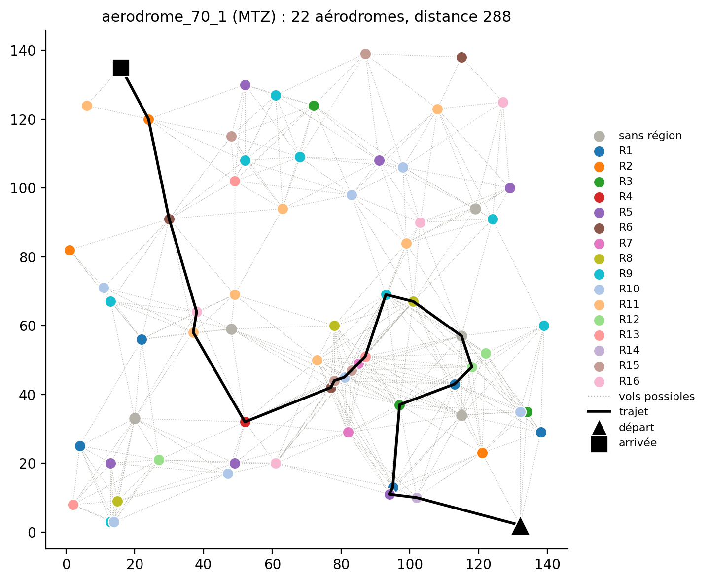

# Optimisation Discrète – Course d'avions
> Un avion doit aller d'un aérodrome de départ à un aérodrome d'arrivée en parcourant la plus petite distance possible. Il doit passer par au moins `Amin` aérodromes et visiter chaque région, sans jamais voler plus de `R` sans se poser.

On compare deux modèles en nombres entiers :
- **Modèle 1 (MTZ)** : un nombre polynomial de contraintes, avec des variables de position pour interdire les sous-tours ;
- **Modèle 2 (sous-tours)** : un nombre exponentiel de contraintes, ajoutées au fur et à mesure quand la solution contient un cycle.

Les modèles, les résultats (borne, temps, nombre de nœuds) et l'analyse sont dans le rapport : [`rapport_Chretienne_Cuel.pdf`](rapport_Chretienne_Cuel.pdf).


## Contenu
| Fichier | Rôle |
|---|---|
| `code.jl` | les deux modèles et la résolution des instances |
| `lecture_distances.jl` | lecture d'une instance (fourni) |
| `instances/` | instances fournies et instances à régions regroupées |
| `tableau.txt`, `parcours.txt` | résultats obtenus (une ligne par instance et par modèle) |
| `tracer_parcours.py` | trace les parcours trouvés dans `cartes/` |
| `generer_instance.py` | crée une instance où les régions sont regroupées |
| `cartes/` | cartes des parcours |


## Installation
Il faut installer JuMP et Gurobi pour exécuter le code, avec une licence « Named-User Academic » obtenue en créant un compte sur le site de Gurobi :
```julia
import Pkg
Pkg.add("JuMP")
Pkg.add("Gurobi")
Pkg.add("Gurobi_jll")
import Gurobi_jll
key = "xxxxxxxx-xxxx-xxxx-xxxx-xxxxxxxxxxxx" # la clé
run(`$(Gurobi_jll.grbgetkey()) $key`)
```
Pour tracer les cartes, il faut aussi `matplotlib` (`pip install matplotlib`).


## Utilisation
```bash
julia code.jl              # résout les instances, ajoute les résultats à tableau.txt et parcours.txt
python3 tracer_parcours.py # crée les cartes
```
Chaque résolution est limitée à 10 minutes. Pour choisir les instances à résoudre, il suffit de modifier le test sur le nom de fichier dans la boucle à la fin de `code.jl`.

